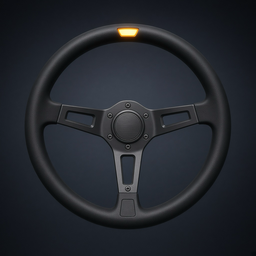

<p align="center">

</p>

# G920 × GameHub

Force feedback for the **Logitech G920** in **Assetto Corsa Competizione** on Apple Silicon Macs when the game runs through **[GameHub](https://gamehub.gg)** (Wine / Proton).

Native macOS does not expose Logitech wheel FFB to Wine. This project ships a menu-bar app that:

1. Lets Wine see the real G920 (keeps GameHub `gamepad_compat_mode` **off** for ACC, sets `SDL_JOYSTICK_MFI=0`)
2. Installs an SDL2 stand-in into the GameHub Wine bottle so game FFB becomes HID++ for the G920
3. Gives live strength / ceiling / invert knobs while you drive

Not a GameHub fork. Does not replace Logitech G HUB, Torqer, or Windows.

Maintained by [**mlsenko**](https://github.com/mlsenko).

## Quick start (no build)

1. Install **GameHub** and **Assetto Corsa Competizione** (Steam `805550`), launch ACC once so the bottle exists.
2. Plug in the **G920** and turn the **power brick** on (USB alone is not enough).
3. Open the ready app from this repo: [`dist/G920.app`](dist/G920.app).
   - First time macOS may block it: right-click → **Open** → **Open**.
4. Look at the menu bar (steering-wheel icon). Status should become **Руль готов**.
   - If it asks to restart GameHub: quit GameHub fully (not just the window) and open it again — once.
5. Start ACC from GameHub, bind the wheel, drive. Adjust **Сила** / **Потолок** / **Инверсия** on the fly.

**After a Mac reboot or macOS update:** open **G920** first, then fully quit and reopen **GameHub**, then launch ACC. `SDL_JOYSTICK_MFI=0` does not stick across reboot until the login helper has run; GameHub only picks it up at process start. Also re-check **System Settings → Privacy & Security → Input Monitoring → GameHub** (updates sometimes clear it).

Since v1.1 the app installs a tiny login helper `~/Library/LaunchAgents/com.mlsenko.g920.env.plist` that only runs `launchctl setenv SDL_JOYSTICK_MFI 0` at login. To remove it: `launchctl bootout gui/$(id -u)/com.mlsenko.g920.env` and delete that file.

If something looks wrong, press **Починить** in the panel.

### Knobs

| Control | Range | Meaning |
| --- | --- | --- |
| Сила (Strength) | 40–120% | Multiplier on torque the game sends |
| Потолок (Ceiling) | 50–100% | Hard clip after scale (try 80–90% for long sessions) |
| Инверсия | off/on | Flip force direction |
| Steering angle | fixed 900° | Not a slider; matches G920 aperture |

Settings live in `~/Library/Application Support/G920/ffb.conf`.

## Feedback & help

This is a DIY project — feedback is welcome, and I’m happy to help.

If something does not work, you are stuck, or you have an idea:

1. Open an **[Issue](../../issues)** on this repository (bugs, questions, or feature ideas — all fine).
2. Say what Mac / macOS / GameHub / ACC setup you use, and what you already tried.

No need to dig privately first. Write here on GitHub; I’ll answer when I can.

## Requirements

- Apple Silicon Mac, macOS 14+
- GameHub with ACC already installed
- Logitech **G920** on USB, power brick on (PID `0xC262`)

## What the app fixes for you

| Problem | What G920.app does |
| --- | --- |
| GameHub “compat” hides the physical wheel | Forces `gamepad_compat_mode: false` for ACC (`805550`) |
| MFI path can steal the device | `launchctl setenv SDL_JOYSTICK_MFI 0` for new processes |
| No game FFB on macOS | Copies the bundled shim into every GameHub Wine `lib/` that has SDL2 |
| GameHub update restored stock SDL | Open the app again or press **Починить** |

Do **not** replace `libSDL2-2.0.0.real.dylib` with the shim — that file is the original SDL. The shim reexports it.

Unplug during a race does not rebind FFB. Quit ACC, replug USB + power, wait, then launch again.

## Build from source (optional)

Only needed if you change the code or want to refresh `dist/`:

```bash
brew install sdl2
xcode-select --install   # if needed
./app/build.sh --install --dist
```

The script auto-finds GameHub’s Wine `lib` (or set `WINE_LIB`). `--dist` updates [`dist/G920.app`](dist/G920.app).

## Layout

```
dist/G920.app  Ready-to-run app (open this)
app/           Menu-bar sources + build script
shim/          SDL FFB stand-in (C)
tools/         Optional research probes
```

## Credits / related work

Research borrowed ideas from (none of these are bundled here):

- [g29-mac](https://github.com/karrvel/g29-mac) — Wine/Whisky SDL shim path for G29
- [crossover-ffb](https://github.com/0xbiel/crossover-ffb) — CrossOver FFB for Logitech wheels
- [g923mac / Wheelio](https://github.com/ivonunes/g923mac) — G923 + bridge approach

G920 Xbox (`046D:C262`) speaks HID++ feature `0x8123`, not the classic 7-byte lg4ff reports used by G29 / G923 PS.

## License

MIT — see [LICENSE](LICENSE).
